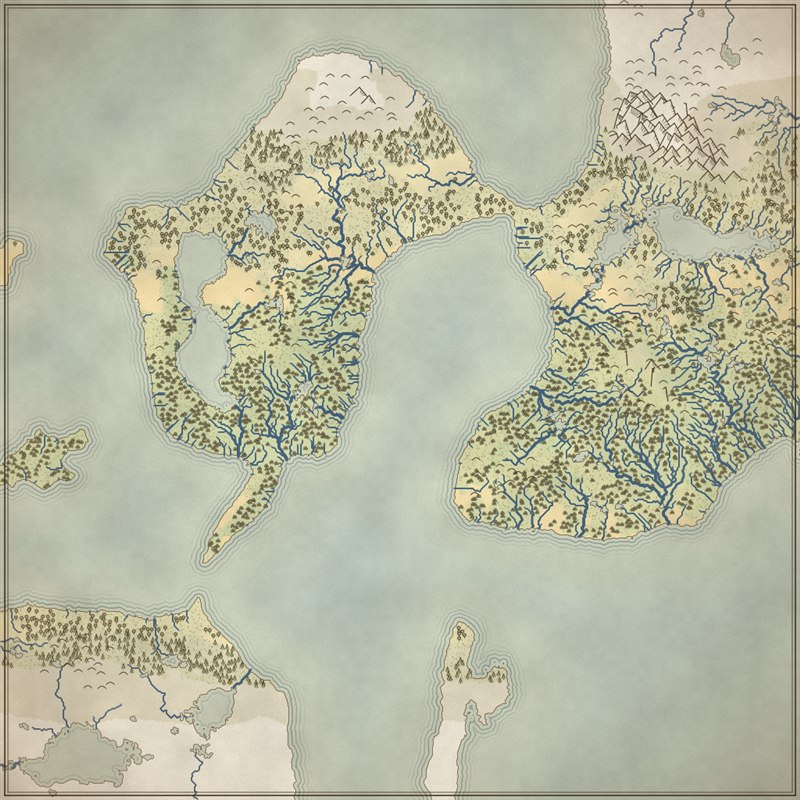

# Procedural World Generator

A deterministic fantasy world generator written in Rust. From a single seed it
simulates plate tectonics, erosion, climate, rivers and biomes, then draws the
result as an antique-style map. It runs as a native desktop app and in the
browser.

**[Open it in your browser →](https://dmadan54.github.io/procedural-world-generator/)**



## Features

- **One seed, one world.** The same seed and settings always produce the
  identical world, on every platform and in the browser.
- **Physically motivated pipeline.** Plates collide to raise mountains, rain
  falls on windward slopes, rivers carve their way to the sea.
- **Antique map style.** Parchment, hatched coastlines, inked rivers that
  taper with flow, mountain glyphs along ranges, stippled forests, marsh
  tufts, settlement marks with hand-lettered names in IM Fell, and peoples'
  names arched across their homelands, and realms washed in hand-applied
  colour inside dotted frontiers, with dotted roads, sea lanes with ships
  and marks for mines, salt pans and grain lands, and crossed swords where
  battles were fought.
- **Peoples with their own languages.** Every culture names its towns, rulers
  and itself in a generated language, so names from one people sound related.
- **World setup.** Choose a layout (continents, archipelago, pangaea,
  islands), sea level, mountain density, climate band, world size, and story
  settings for magic, politics, disasters and history. Start from one of four
  presets: Classic High Fantasy, Grounded Historical, Mythic Age and
  Archipelago.
- **Share links.** "Copy share link" gives a short URL that opens exactly
  the same world for anyone.
- **History with a time slider.** Scrub or play through the centuries and
  watch realms rise, split and fall; an event feed lists what happened and
  why, and the year shows in an antique cartouche.
- **Debug views for every stage.** Inspect plates, relief, noise, erosion,
  temperature, rainfall, winds, drainage and biomes from the View menu.

## How a world is made

Each stage reads the outputs of the ones before it and has its own debug view.

| Stage | What it does | Debug view |
|---|---|---|
| Tectonics | Scatters 8–40 plates, gives each a drift and an oceanic or continental type, and turns converging, diverging and sliding boundaries into mountain belts, trenches, ridges and rifts. | Tectonic plates, Tectonic relief |
| Noise | Fractal (FBM) noise for detail. | Fractal noise |
| Heightmap | Blends tectonic relief with noise on a fixed scale, so sea level means the same in every world. | Heightmap |
| Erosion | Simulates water droplets that carve valleys and deposit sediment. Runs in the background with a progress bar; parallel on desktop. | Erosion change, before/after toggle |
| Climate | Temperature from latitude and altitude; prevailing winds in three bands; rain carried downwind and dropped on slopes, leaving rain shadows behind ranges. | Temperature, Precipitation, Prevailing winds |
| Hydrology | Fills depressions into lakes, routes water downhill and traces rivers as connected polylines with discharge, ready for later stages to query. | Drainage |
| Biomes | Classifies each cell from its climate and elevation (ice, tundra, alpine, forests, grassland, desert, savanna and more) with noise-ragged borders, adds wetlands and mangroves on flat wet ground, and smooths away speckle. | Biomes, with coverage and a Whittaker diagram |
| Habitability | Scores land from its biome, fresh water, sheltered coast, slope and altitude. | Habitability |
| Peoples | Places cultures on the best land and spreads them over a travel-cost map so homelands end at mountains and seas; each gets traits and its own naming language. | Peoples |
| Settlements | Places villages, towns, cities and capitals on the best sites, ranks them by population, flags ports, river crossings, passes and oases, and names them in their people's language. | Settlements |
| Resources | Places ore and gems along colliding plates and in high ground, timber in forests, grain on fertile river land and salt on arid coasts and dry lake shores, and works out what each settlement produces. | Resources |
| Roads | Joins settlements with roads found by A* over the travel-cost map (later roads join earlier ones), links towns along navigable rivers and ports by sea lanes. | Roads and sea lanes |
| Realms | Founds a realm at each capital and grows its territory over the travel-cost map, so borders follow mountains, rivers and straits; each realm takes a government, name, ruling house and arms from its people. | Realms |
| History | Simulates centuries as an append-only event log: rulers die and are succeeded, frontiers shift, goods are traded along the network (realms grow rich on tolls), realms ally, marry, feud, swear fealty and go to war, fighting named battles at real fords, passes and towns, strong realms conquer weak ones and large ones break apart, towns grow, dwindle, are founded and renamed. Every event records its cause; snapshots make any year instant to show. | Realms, trade and diplomacy by year; event feed; click a realm for its relations, wars and rulers |

Politics and history settings drive the realm and history stages. Magic and
disaster settings travel with each world but no stage uses them yet.

## Running it

You need a Rust toolchain ([rustup](https://rustup.rs)). After cloning, enable
the repo's git hooks once with `git config core.hooksPath .githooks`.

```sh
# Desktop app
cargo run --release -p worldgen-app

# Open a shared world (a full link or just the code)
cargo run --release -p worldgen-app -- --world "<link or code>"

# Tests
cargo test --workspace
cargo test -p worldgen-core --features parallel
```

### In the browser

The web build uses [Trunk](https://trunkrs.dev):

```sh
rustup target add wasm32-unknown-unknown
cargo install trunk
cd app
trunk serve
```

Then open <http://localhost:8080>. Every push to `main` builds the site and
deploys it to GitHub Pages (see `.github/workflows/pages.yml`).

### Windows note

With the GNU toolchain (`x86_64-pc-windows-gnu`), building the desktop app
needs a full MinGW-w64 on your `PATH`, for example
[WinLibs](https://winlibs.com) (`winget install BrechtSanders.WinLibs.POSIX.UCRT`).
The MSVC toolchain with Visual Studio Build Tools works without it.

## Project layout

```
core/   worldgen-core: all generation logic, no UI dependencies
  src/config.rs      WorldConfig: every setting, serialisable
  src/rng.rs         seeded randomness, one stream per stage
  src/world.rs       the pipeline, with incremental updates
  src/share.rs       compact share codes
  src/tectonics.rs, fractal.rs, heightmap.rs, erosion.rs,
  src/climate.rs, hydrology.rs, biome.rs   one file per stage
app/    worldgen-app: the eframe UI (desktop and web)
  src/style/         map styles (MapStyle trait, antique style, lettering)
  assets/fonts/      IM Fell English (SIL Open Font License)
  src/setup.rs       world setup window and presets
  src/link.rs        share links
  presets/           preset configs as JSON
```

### Determinism

All randomness comes from a ChaCha RNG derived by hashing the world seed with
a stage name, so stages never share or disturb each other's random streams:
turning on a later feature cannot change earlier output. Parallel erosion
splits work into fixed chunks and merges them in order, so it gives the same
bytes as the single-threaded web build.

### Adding a map style

Implement `MapStyle` (a name and a `render(&World) -> Canvas`) in a new module
under `app/src/style/` and add it to `all_styles()`. Styles only read the
world, so they never need changes to the generator.
